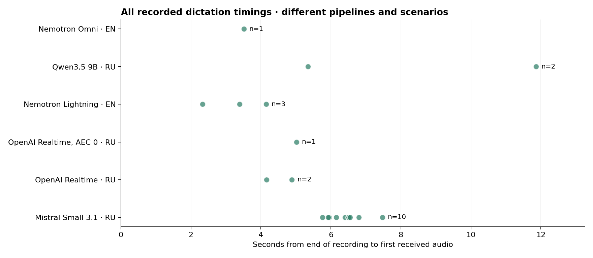
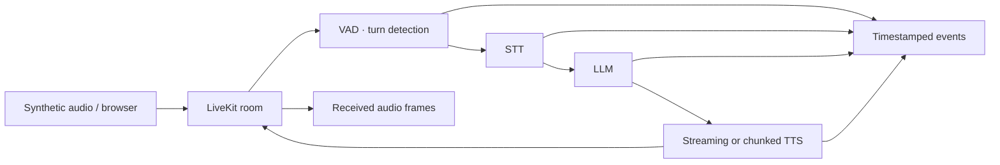
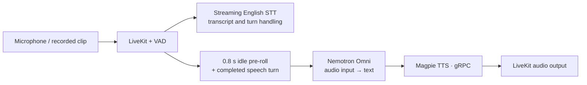
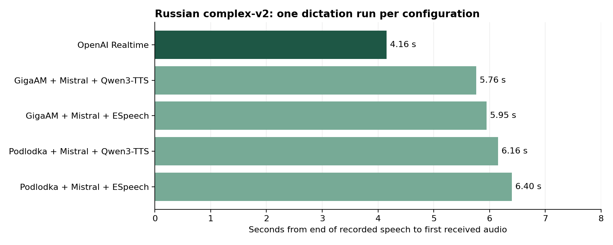
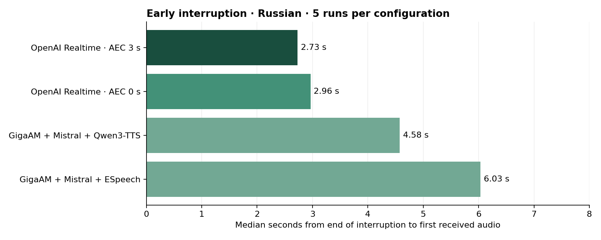
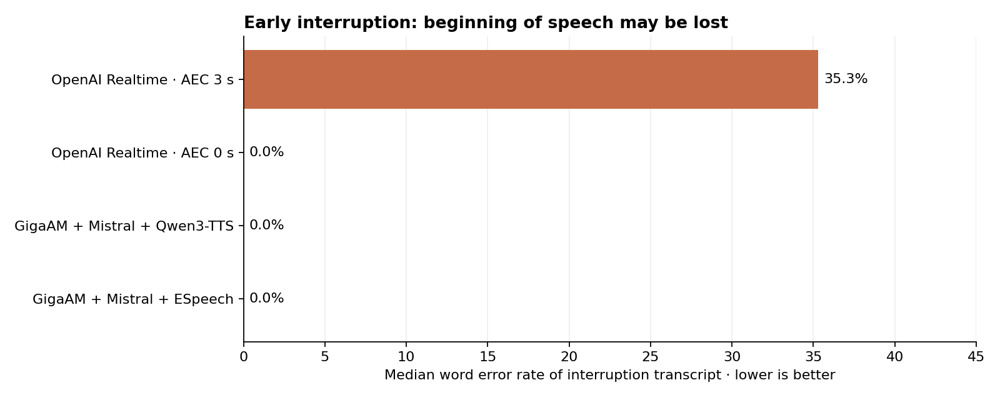
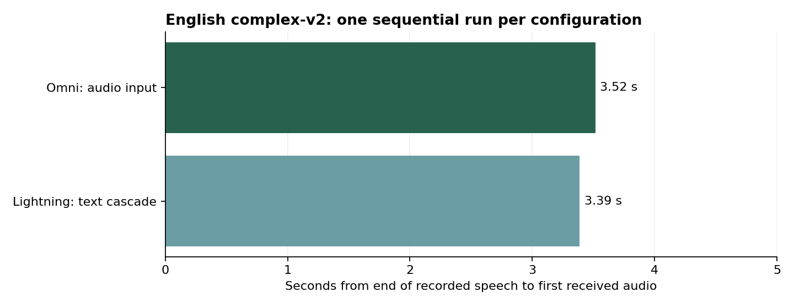
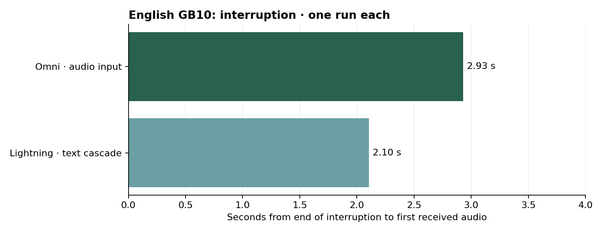

# Voice AI Benchmark Research

### LiveKit voice agents · streaming and interruption · NVIDIA GB10

A practical benchmark of speech recognition, language models, text-to-speech, end-of-turn detection, and interruption handling. It covers **Russian cloud pipelines**, a **closed-model realtime baseline**, and **English local pipelines on NVIDIA GB10**.

The repository includes the research findings, charts, anonymized synthetic run metrics, and the measurement and adapter code. It contains **no API keys, personal conversations, or user audio recordings**.

> **Read the results as an engineering investigation, not a model leaderboard.** Languages, voices, providers, instructions, workload, and audio paths differ. Most data points are single synthetic runs; only the early-interruption experiment below has five runs per configuration. None measure sound actually heard from a physical speaker.

---

## Executive summary

| Question | What we observed | What this does **not** prove |
|---|---|---|
| Can a fully local voice pipeline run on GB10? | Yes. Nemotron Speech EN, Lightning or Omni, and Magpie ran on one rented GB10. | Production readiness, concurrent-user capacity, Russian support, or low latency on every GB10. |
| How did Lightning and Omni compare? | In one English run each, both transcribed the interruption and answered both questions correctly. Lightning received new audio in **2.11 s**, Omni in **2.93 s**. | A stable speed advantage: tests were sequential at different times, with different model input paths. |
| Did speech interruption work? | Yes on selected synthetic clips. In a separate 20-run Russian study, AEC warmup changed whether the start of an early interruption appeared in the transcript. | Echo resistance or false-interruption behavior with a real microphone and loudspeaker. |
| How did cloud configurations perform? | Selected Russian dictation samples reached first received audio in **4.16–6.40 s**. | A universal ranking: the realtime baseline and cascade pipelines have different architectures and settings. |
| Did function calling work? | Simulated calls were detected in selected Russian runs. | Real phone calls. Function calling was disabled for the Omni comparison. |

**Important terminology:** “open-weight” below means that model weights were published. It does **not** mean that every model has an OSI-approved license or identical commercial-use rights. Check each model and provider separately.

## Contents

- [System architecture](#system-architecture)
- [Benchmark design and measurements](#benchmark-design-and-measurements)
- [Russian: cloud and open-weight pipelines](#russian-cloud-and-open-weight-pipelines)
- [Interruption: 20-run study](#interruption-20-run-study)
- [English: Lightning vs Omni on GB10](#english-lightning-vs-omni-on-gb10)
- [Hardware, deployment, and settings](#hardware-deployment-and-settings)
- [Interpretation and limitations](#interpretation-and-limitations)
- [Data and code](#data-and-code)
- [Reproducing the measurements](#reproducing-the-measurements)
- [Next experiments](#next-experiments)

## Overall results: all tested language models



Each dot is an individual run, **not a model-only score**. Runs within a row may use different STT/TTS, settings or fixture sets; Russian and English recordings differ. Missing measurements are excluded. The chart is an overview, not a comparable ranking.

| LLM / voice model | Access | Language | Deployment in this test | Recorded dictation audio latency | Runs |
|---|---|---|---|---:|---:|
| OpenAI Realtime, AEC 3 s | Closed | Russian | Cloud realtime | 4.16–4.88 s | 2 |
| OpenAI Realtime, AEC 0 s | Closed | Russian | Cloud realtime | 5.01 s | 1 |
| Mistral Small 3.1 24B | Published weights | Russian | OpenRouter + NeuralDeep | 5.76–7.47 s | 8 |
| Qwen3.5 9B | Published weights | Russian | OpenRouter + NeuralDeep | 5.34–11.86 s | 2 |
| Nemotron Omni 30B A3B | Published weights | English | GB10 + Nemotron STT + Magpie | 3.52 s | 1 |
| Nemotron Lightning 30B A3B | Published weights | English | GB10 + Nemotron STT + Magpie | 2.33–4.15 s | 3 |

Latency ranges reflect only recorded runs with a dictation audio measurement, not percentiles or a controlled comparison. Other models shown in the UI but absent from this table have no such saved measurement in this dataset. See the per-language and interruption sections for quality and scenario details.

## System architecture

### Text cascade



### Audio-input Omni path



Omni receives the **completed turn as audio**, then its streamed text is synthesized separately. This is not a native continuous full-duplex speech-to-speech Omni implementation. Captured turns are capped at 20 seconds in this experiment.

### Components

| Component | Role in the investigation |
|---|---|
| **LiveKit / LiveKit Agents 1.8.11** | Rooms, audio transport, agent orchestration and events. |
| **Silero VAD** | Speech activity and turn boundaries. |
| **OpenRouter** | Hosted LLM access. Actual upstream hardware, model quantization, and load were not recorded. |
| **NeuralDeep** | Selected hosted STT and TTS models. |
| **OpenAI Realtime** | Closed-model cloud reference, including generated audio. |
| **NeMo-Speech.cpp** | Streaming Nemotron Speech English and Magpie/NanoCodec on GB10. |
| **llama.cpp** | Nemotron 3.5 Lightning 30B A3B, GGUF Q4_0 on GB10. |
| **vLLM 0.20.0 + CUTLASS** | Nemotron 3 Nano Omni 30B A3B NVFP4 on GB10. |

## Benchmark design and measurements

The full dataset contains **59 anonymized synthetic-run records**, including exploratory and incomplete tests. A `completed` run means that the test process completed; it does not mean every case or metric succeeded. Results and timestamps are in [`data/runs.json`](data/runs.json).

### Scenarios

1. **Dictation:** transcribe a multi-part instruction. Word error rate (WER) measures insertions, deletions and substitutions after normalization.
2. **Short pause:** insert 0.2 seconds inside a question; the test expects one user turn.
3. **Long pause:** insert 1.5 seconds; the test expects two turns. This is a test expectation, not a rule for all human speech.
4. **Interruption:** interrupt a story with a new question. Inspect transcription, the appearance of a new response, and whether the requested facts are answered.
5. **Function calling:** prepare a simulated contact-call action without placing a call. This case was not enabled for the English Omni comparison.

The Russian `complex-v2` and English adaptation use different sentences and audio; the shorter English smoke test is another distinct set. The public code uses pseudonyms in Russian fixture text, so newly generated clips will not be byte-identical to the original recordings.

### Definitions

| Metric | Start → end | Limitation |
|---|---|---|
| **First received audio** | End of the sent synthetic recording → first detected audio frame at the test client. | Not sound from the physical device or human-perceived latency. |
| **Post-interruption audio** | End of the interruption recording → first detected subsequent audio frame. | This is not the time until the previous speech actually becomes silent on a speaker. |
| **Agent-state interruption** | User speaking state → agent changes from speaking. | Server event; network and playback buffers are excluded. |
| **First LLM token / TTS chunk** | Internal provider events. | Separate events may belong to different turns or audio chunks; do not add their medians. |
| **WER** | Word-level distance from a fixed reference. | Sensitive to transcription and normalization; one clean voice is not representative of real users. |

## Russian: cloud and open-weight pipelines



Each row is **one Russian `complex-v2` run**. OpenAI Realtime is a closed-model baseline; the other rows combine hosted models with published weights. They are whole-pipeline measurements, not isolated model benchmarks.

| STT / LLM / TTS | Dictation WER | To transcript | To first received audio | Run ID |
|---|---:|---:|---:|---|
| OpenAI Transcribe / Realtime / Realtime | 0% | 2.02 s | **4.16 s** | `31382bf9…` |
| GigaAM v3 / Mistral / Qwen3-TTS | 0% | 1.97 s | 5.76 s | `78730a2a…` |
| GigaAM v3 / Mistral / ESpeech | 0% | 2.43 s | 5.95 s | `eb795c23…` |
| Whisper Podlodka / Mistral / Qwen3-TTS | 8% | 3.05 s | 6.16 s | `2cac3534…` |
| Whisper Podlodka / Mistral / ESpeech | 16% | 2.60 s | 6.40 s | `5759704d…` |

A separate GigaAM / Mistral / Qwen3-TTS run took **6.79 s** to first audio, illustrating why small differences between individual runs should not be treated as stable advantages. The five full runs above detected both expected pause boundaries and the simulated contact-call action; they did not place real calls.

### Mistral vs Qwen: exploratory sample

With Whisper Podlodka Turbo and ESpeech on Russian `complex-v2`, one Mistral run took **7.47 s** to first audio and one Qwen3.5 9B run took **11.86 s**. The STT timing and transcript also differed. This is insufficient to conclude that one LLM is intrinsically faster than the other.

## Interruption: 20-run study

Four configurations, five runs each, three synthetic voices (Alloy/Nova/Onyx distributed 1/2/2). The table reports medians and checks whether both requested facts appeared in the response.





| Configuration | Median interruption WER | Both requested facts | Median post-interruption audio |
|---|---:|---:|---:|
| OpenAI Realtime · AEC warmup 3 s | 35.3% | 5/5 | **2.73 s** |
| OpenAI Realtime · AEC warmup 0 s | 0% | 5/5 | 2.96 s |
| GigaAM / Mistral / Qwen3-TTS | 0% | 4/5; one not evaluated | 4.58 s |
| GigaAM / Mistral / ESpeech | 0% | 5/5 | 6.03 s |

With 3-second AEC warmup, the **beginning** of the early interruption was lost in these tests, although the remaining question still led to the two correct facts. One ESpeech run recorded a service error. Zero warmup preserved the synthetic phrase but may increase echo or false interruption on real hardware; those acoustic effects were not tested.

## English: Lightning vs Omni on GB10





Both runs used Nemotron Speech Streaming EN, Magpie TTS voice John, temperature 0.6, and the same existing English fixture directory. The current clips were checked against their SHA-256 manifest; the earlier Omni result did **not** separately store fixture hashes, so historical byte identity cannot be independently proven. The tests ran at different times and represent different processing paths.

| Scenario | Omni: audio input | Lightning: STT → text LLM |
|---|---|---|
| Long dictation | WER 0%, one transcript turn | WER 0% across combined transcript, two turns |
| Dictation: first received audio | 3.52 s | **3.39 s** |
| 0.2 s pause | One turn; concise umbrella/jacket answer | One turn; useful answer with an unnecessary request for location |
| 0.2 s pause: first audio | 2.88 s | **2.35 s** |
| 1.5 s pause | Two turns; first described the recorded speech | Two turns; first mentioned unavailable live forecast |
| Story start | Offered to tell a story; story itself not captured in the result | Began the story; generation was interrupted |
| Interruption | WER 0%; correctly answered “seven days” and “Thursday” | WER 0%; same correct facts; offered to continue the story |
| New audio after interruption ends | 2.93 s | **2.11 s** |
| Agent-state change on interruption | 448 ms | 452 ms |
| Function calling | Not tested | Not tested for parity with Omni |

In an earlier and shorter English smoke test, streaming Lightning produced first dictation audio in **2.33 s** and first new audio after interruption in **1.74 s**. Its phrases differ from the complex scenario, so do not compare those two measurements as equivalent.

## Hardware, deployment, and settings

The rented **NVIDIA GB10** had 128 GB of unified CPU/GPU memory, **not** 128 GB of free dedicated VRAM. The instance was an unprivileged Vast.ai container. Results describe this specific experimental setup; GPU capacity and memory availability vary with the host and other running processes.

| Setting | Russian cascades | English GB10 | Realtime reference |
|---|---|---|---|
| Temperature | 0.6 in selected runs | 0.6 | Governed by reference agent/model |
| VAD threshold / silence | 0.5 / 0.55 s | 0.5 / 0.55 s | OpenAI server VAD threshold 0.75 |
| End-of-turn delay | 0.8 s | 0.8 s | Server VAD silence 800 ms; prefix padding 300 ms |
| Interruption minimum | 0.5 s | 0.5 s | Reference implementation; AEC variants tested separately |
| AEC warmup | 0 s in selected runs | 0 s | 3 s baseline, separate 0 s experiment |
| Model instructions | No general system prompt in the selected cascade | Omni task hint off in comparison | Reference agent instructions apply |
| TTS | Provider dependent | Magpie streaming gRPC | Native Realtime audio |

Lightning: Q4_0 GGUF, context length 4096, `parallel=1`. Omni: NVFP4, vLLM `max-model-len=4096`, `max-num-seqs=1`, `gpu-memory-utilization=0.38`, `--enforce-eager`, CUTLASS. These are research settings, **not** NVIDIA Blueprint defaults or a tuned multi-user deployment.

The original GB10 instance has been deleted. The [example service launch files](docs/) are configuration snapshots with paths that must be adapted. Model weights, GPU image and environment are not included.

## Interpretation and limitations

- **No universal ranking:** English and Russian scenarios have different clips, STT/TTS, models and timing conditions. A locally hosted model and a hosted API cannot be ranked solely from these samples.
- **Single runs are noisy:** compare distributions after repeated runs, not 0.1–0.5 s differences from isolated examples.
- **Published weights ≠ identical licenses:** each model and service has separate terms.
- **No user-device acoustic evaluation:** real speakers, room echo, speech overlaps, backgrounds and older speakers remain untested.
- **No model-output guarantee:** Omni sometimes described audio instead of answering. A previous integration issue involving model-history formatting was corrected; an earlier buffer could have included substantial background audio, but the original real audio was not retained to verify its actual content.
- **No language generalization:** local Nemotron Speech here was English. These results do not establish a Russian local GB10 pipeline.
- **No complete tool or production validation:** simulated functions are not real calls, Omni tools were disabled, and `max-num-seqs=1` is not a concurrency benchmark.
- **Streaming is stage-specific:** audio transport, recognition, LLM text, and synthesis may each use different buffering. A stream in one stage does not establish end-to-end streaming.

## Data and code

```text
README.md                  Full report and methodology
charts/                    Six reproducible charts
code/benchmark_suite.py    Synthetic LiveKit test client and metrics
code/example_lightning_complex_en.py  English scenario example
code/*_stream.py           Nemotron / Magpie research adapters
code/omni_agent.py         Omni audio-input adapter
code/neuraldeep_tts.py     Provider adapter
code/summarize.py          Convert anonymized results to CSV
code/charts.py             Regenerate charts from JSON
code/test_*.py             Adapter and data smoke tests
data/runs.json             59 synthetic runs; selected metadata and metrics
docs/                      GB10 service command snapshots
```

The dataset contains synthetic-run configurations and selected metrics, **not** raw recordings or personal conversations. Some early results lack specific measurements; absent values should not be interpreted as zero or as a successful result.

### Inspect the dataset locally

Python 3.9+; no credentials or network required:

```bash
python3 code/summarize.py > summary.csv
PYTHONPATH=code python3 -m unittest discover -s code -p test_summarize.py -v
```

Regenerate charts with `matplotlib` installed:

```bash
python3 -m pip install matplotlib
python3 code/charts.py
```

## Reproducing the measurements

**The published code is a research integration client, not a turnkey voice server.** To rerun voice scenarios you need:

1. A running LiveKit deployment and voice agent connected to the selected STT, LLM and TTS services.
2. A compatible management API: `POST /api/v1/benchmarks/voice` accepts a configuration and bearer token, returns `id`, `server_url`, and `participant_token`; `POST /api/v1/benchmarks/voice/{id}/close` closes the run. The agent must send the event payloads expected by `benchmark_suite.py` on the LiveKit `benchmark` data topic.
3. Your own model endpoints, credentials and compatible model files. The original management API, UI, GPU image, credentials and weights are **not** included.
4. A Python environment with [`requirements.txt`](requirements.txt). Some dependencies use version ranges, so capture an environment lock file for future work. Fixture generation and external API requests may incur charges.

Example, after supplying your own compatible API, configuration file and short-lived token:

```bash
export BENCHMARK_API_URL=http://localhost:8000
# Set OPENAI_API_KEY in the environment only if generating new synthetic clips.
python3 code/example_lightning_complex_en.py \
  --fixtures ./fixtures/english \
  --config ./config.json \
  --output ./results.json < ./short_lived_token
```

Endpoint variable names are documented in [`.env.example`](.env.example). Do not commit real credentials or expose model endpoints publicly without appropriate authentication. The historical fixture audio is not included; newly generated recordings will not be identical to previous ones.

## Next experiments

1. Run each comparable scenario at least 10 times; report median, p90, errors, timeouts, cold/warm state, model versions, prompts, load and fixture hashes.
2. Test real microphones and loudspeakers with echo, different voices and noise; measure actual playback start and interruption silence at the device.
3. Compare Omni with and without a short task instruction using identical stored clips, including negative instructions, long pauses and background noise.
4. Add a controlled function-calling experiment to the Omni adapter before evaluating actions.
5. Evaluate a Russian local STT/TTS stack on GB10 separately; English results do not transfer automatically.
6. Measure long sessions, repeated interruptions, recovery after restart and simultaneous users.

## License

Repository code and text: [MIT](LICENSE). Individual model weights, datasets, SDKs and hosted services have separate licenses and terms.
