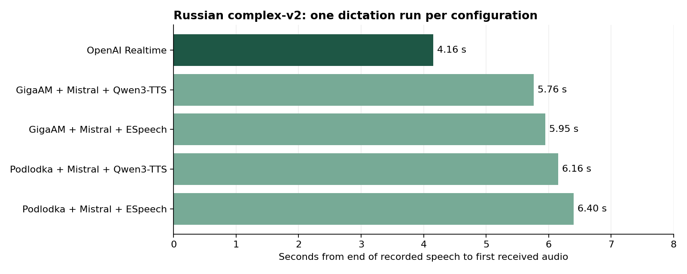
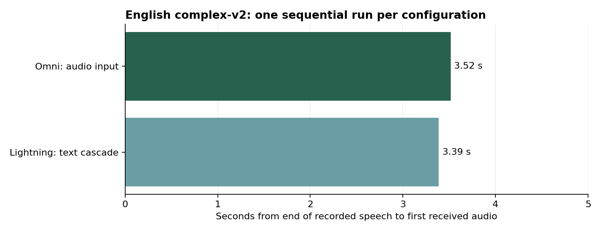

# Исследование голосовых моделей: LiveKit, облачные сервисы и NVIDIA GB10

**Период:** 15–16 ноября 2026 года
**Тип исследования:** инженерный бенчмарк потокового диалога и перебивания
**Данные:** 59 обезличенных результатов синтетических прогонов, включая сравнительный английский прогон Lightning и Omni.

## Краткий результат

Рабочий голосовой диалог удалось построить как на облачных моделях, так и на арендованной NVIDIA GB10 с локальными моделями. При этом единичные задержки нельзя считать универсальным рейтингом: в тестах менялись язык, модели распознавания и озвучивания, провайдеры, параметры и тип модели.

- На русском в выбранных единичных прогонах **закрытый OpenAI Realtime** отвечал аудио через 4,16 с; каскады с доступными весами — через 5,76–6,40 с.
- В серии из 20 синтетических тестов раннего перебивания настройка прогрева эхоподавления сильно влияла на потерю начала фразы. Без реального динамика и микрофона вывод об оптимальной настройке делать рано.
- На GB10 в английском сложном сценарии **Nemotron Lightning** и **Nemotron Omni** сохранили перебивающую фразу и правильно ответили на два вопроса. Первый новый аудиокадр после её окончания получен за 2,11 и 2,93 с соответственно — по одному запуску, в разное время.
- Omni в одном сценарии описала входной звук вместо ответа. Lightning в другом дал избыточный ответ. Функции для Omni в тестируемом адаптере не были включены.

**Ограничение:** это синтетическая речь и экспериментальные конфигурации. Измерения не подтверждают производительность и качество на устройстве пользователя, при шуме, разной речи и длительной нагрузке.

## 1. Срезы исследования

| Срез | Что вошло | Как сравнивать |
|---|---|---|
| Модели с опубликованными весами | Mistral Small 3.1, Qwen3.5, Nemotron Lightning и Omni; GigaAM и другие речевые модели | Условия и лицензии моделей различаются; доступность весов не равнозначна одинаковым коммерческим правам |
| Закрытая модель | OpenAI Realtime — контрольный облачный вариант | Оценивается весь аудиотракт, а не только LLM; самостоятельное развёртывание не проверялось |
| Русский | OpenAI Realtime и каскады STT + Mistral/Qwen + TTS | Сравниваются результаты на русском synthetic `complex-v2` при указанных настройках |
| Английский | Lightning и Omni на GB10 | Сравниваются английские синтетические сценарии; старый запуск Omni не сохранил хэш аудиофайлов |
| Облако | OpenRouter, NeuralDeep, OpenAI | Провайдер инференса, фактическое квантование и нагрузка за пределами нашего контроля |
| Локальный GB10 | Nemotron Speech, Lightning, Omni, Magpie | Один арендованный GPU-инстанс, не тест многопользовательской нагрузки |

## 2. Методология

Проверялись длинная диктовка, определение конца фразы с паузами 0,2 и 1,5 с, перебивание рассказа, ответ на новую сложную фразу и вызов тестовой функции. Для диктовки и перебивания использовался WER: доля заменённых, удалённых и вставленных слов после нормализации текста. WER 0% в одном случае не гарантирует точность в реальной речи.

Тракт: синтетический клиент → **LiveKit / LiveKit Agents** → VAD и определение конца реплики → STT → LLM → TTS → LiveKit-клиент. Omni отличается: она получает аудио завершённой фразы, а отдельный STT используется для транскрипции и управления ходом разговора; ответ Omni переводится в речь через Magpie.

**Основная метрика задержки** — от конца отправленной записи до первого аудиокадра, полученного тестовым клиентом. Она не измеряет время до фактического звука из динамика. Метрики модели и перехода состояний не следует складывать: они могут относиться к разным событиям.

| Компонент | Применение |
|---|---|
| LiveKit Agents | Оркестрация комнат, агент и события голосового взаимодействия; версия стенда 1.8.11 |
| Silero VAD | Обнаружение речи и пауз |
| OpenRouter | Облачный доступ к Mistral/Qwen; конкретный провайдер инференса и квантование не фиксировались |
| NeuralDeep | STT GigaAM/Whisper и TTS Qwen3-TTS/ESpeech в соответствующих прогонах |
| NeMo-Speech.cpp | Потоковый Nemotron Speech English, Magpie TTS/NanoCodec на GB10 |
| llama.cpp | Nemotron 3.5 Lightning 30B A3B Q4_0 на GB10 |
| vLLM 0.20.0 + CUTLASS | Nemotron 3 Nano Omni 30B A3B NVFP4 на GB10 |

Параметры примеров: температура 0,6; ожидание завершения фразы 0,8 с; порог VAD 0,5 и тишина VAD 0,55 с; порог перебивания 0,5 с; AEC warmup 0 с для каскадов и английских GB10-прогонов. Контроль OpenAI имел собственную настройку server VAD 0,75, 800 мс, prefix padding 300 мс и в базовом варианте AEC warmup 3 с. Подробные поля сохранены в [данных прогонов](data/runs.json).

## 3. Общие результаты по сценариям

| Сценарий | Что удалось проверить | Основное ограничение |
|---|---|---|
| Диктовка | На некоторых русских и английских синтетических примерах WER 0% | Короткий набор не оценивает шум, диалекты и естественную речь |
| Короткая пауза | В выбранных полных прогонах пауза 0,2 с осталась внутри реплики | Не гарантирует правильное завершение при нестандартной манере речи |
| Длинная пауза | Пауза 1,5 с разделяла фразу на две | Модель могла ответить на незаконченную мысль или описать звук |
| Перебивание | Обе конфигурации GB10 в английском тесте распознали запрос и ответили правильно | Проверка синтетическая, без обратного эха через колонку |
| Тестовая функция | В выбранных русских конфигурациях подготовка тестового действия зафиксирована | Реального действия не было; в Omni функции не тестировались |

## 4. Русский язык: облачные конфигурации

`complex-v2`, отдельные прогоны; время до первого аудиокадра. OpenAI Realtime — закрытый контроль, остальные варианты используют опубликованные веса, предоставленные облачными провайдерами.

| Распознавание / модель / озвучивание | WER | До текста | До первого аудио | Прогон |
|---|---:|---:|---:|---|
| OpenAI Transcribe / Realtime / Realtime | 0% | 2,02 с | 4,16 с | `31382bf9…` |
| GigaAM v3 / Mistral / Qwen3-TTS | 0% | 1,97 с | 5,76 с | `78730a2a…` |
| GigaAM v3 / Mistral / ESpeech | 0% | 2,43 с | 5,95 с | `eb795c23…` |
| Whisper Podlodka / Mistral / Qwen3-TTS | 8% | 3,05 с | 6,16 с | `2cac3534…` |
| Whisper Podlodka / Mistral / ESpeech | 16% | 2,60 с | 6,40 с | `5759704d…` |

В другом запуске GigaAM / Mistral / Qwen3-TTS показал 6,79 с. Из единичных измерений нельзя выводить устойчивое преимущество, особенно при разных инструкциях, нагрузке и режимах.

В отдельном сравнении Podlodka + ESpeech: Mistral показал 7,47 с, Qwen3.5 9B — 11,86 с. Задержка STT и качество транскрипции также различались, поэтому это **не чистое сравнение LLM**.

### Перебивание: 20 запусков

По пять прогонов на конфигурацию, три синтетических голоса, одинаковая структура фразы. Таблица показывает медианы и ручную/текстовую проверку двух фактов в ответе.

| Конфигурация | WER перебивающей фразы | Два факта в ответе | До нового аудио, медиана |
|---|---:|---:|---:|
| OpenAI Realtime, прогрев AEC 3 с | 35,3% | 5/5 | 2,73 с |
| OpenAI Realtime, прогрев AEC 0 с | 0% | 5/5 | 2,96 с |
| GigaAM / Mistral / Qwen3-TTS | 0% | 4/5; один не оценён | 4,58 с |
| GigaAM / Mistral / ESpeech | 0% | 5/5 | 6,03 с |

В варианте с AEC 3 с терялось начало ранней реплики, хотя оба факта дошли до ответа. Это не основание отключать эхоподавление на реальном устройстве без проверки ложных реакций и качества звука. В одном прогоне ESpeech зафиксирована ошибка сервиса.

## 5. Английский язык: локальный GB10

Обе конфигурации использовали Nemotron Speech Streaming EN, Magpie TTS John и одну директорию английских тестовых файлов. Текущие файлы проверены по SHA-256; в старом результате Omni отдельный манифест хэшей не сохранился. Запуски выполнялись последовательно в разное время; результаты зависят от загрузки.

| Проверка | Omni: аудиовход | Lightning: текстовый каскад |
|---|---|---|
| Диктовка | WER 0%, одна реплика | WER 0% по объединённому тексту, две реплики |
| Диктовка: до первого аудио | 3,52 с | 3,39 с |
| Короткая пауза | Одна реплика; краткий ответ по условию | Одна реплика; ответ по существу, но с лишним запросом города |
| Короткая пауза: до первого аудио | 2,88 с | 2,35 с |
| Длинная пауза | Две реплики; сначала описание аудио | Две реплики; сначала предупреждение о недоступности прогноза |
| Начало сказки | Обещание рассказать; сама сказка в результате не зафиксирована | Начал сказку; генерация прервана |
| Перебивание | WER 0%, ответ: семь дней и четверг | WER 0%, ответ: семь дней и четверг |
| Аудио после конца перебивания | 2,93 с | 2,11 с |
| Переход состояния при перебивании | 448 мс | 452 мс |
| Вызов функций | Не тестировался | Не тестировался для сопоставимости |

На отдельном более коротком английском `smoke` потоковый Lightning показал 2,33 с до аудио после диктовки и 1,74 с до нового аудио после перебивания. Это другой набор фраз; напрямую сравнивать его с таблицей выше нельзя.

## 6. Настройка GB10

GB10 располагает 128 ГБ общей памяти CPU/GPU; это не 128 ГБ свободной выделенной VRAM. Lightning запускался в llama.cpp с GGUF Q4_0, контекстом 4096 и одним параллельным запросом. Omni запускалась в vLLM с `max-model-len=4096`, `max-num-seqs=1`, `gpu-memory-utilization=0.38`, `--enforce-eager` и CUTLASS. Magpie использовалась с потоковым gRPC.

Это экспериментальная сборка, а не полный NVIDIA Blueprint и не проверка производительности при нескольких одновременных клиентах. Примеры команд Supervisor находятся в [docs](docs/); пути к моделям и ПО нужно адаптировать. Веса, окружение CUDA и секреты в репозиторий не включены.

## 7. Что измерить дальше

1. Повторить каждый сравнимый сценарий не менее десяти раз: медиана, p90, доля тайм-аутов и ошибок, температура, прогрев, версии и загрузка GPU.
2. Тестировать один и тот же язык и зафиксированные аудиофайлы с сохранением SHA-256 для каждого запуска.
3. Добавить реальный микрофон и колонку: эхо, фоновая речь, разные голоса, устройства и уровни громкости; измерять акустическую остановку и начало ответа на устройстве.
4. Сравнить Omni с короткой инструкцией задачи и без неё на одинаковых аудиофайлах и негативных командах.
5. Отдельно проверить функции, длительные ответы, непрерывные разговоры и несколько одновременных пользователей.
6. Подобрать и испытать отдельный русский локальный STT/TTS на GB10: результаты английской сборки не подтверждают работу русского.

## 8. Данные, код и ограничения воспроизводимости

- [Обезличенные результаты `runs.json`](data/runs.json) включают настройки, идентификаторы синтетических сценариев, агрегаты и технические метрики. Они не содержат реальные диалоги или аудио.
- [Клиент сценариев](code/benchmark_suite.py) и [английский пример](code/example_lightning_complex_en.py) показывают методику, передачу фраз в LiveKit и замеры. В именах в русскоязычных примерах использованы псевдонимы; новые тестовые аудиозаписи потребуют повторной генерации и не будут побитно идентичны старым.
- [Адаптеры](code/) Nemotron STT, Omni, Magpie и NeuralDeep — код исследовательской интеграции. Адреса моделей задаются через переменные окружения.
- Для автоматического запуска клиенту нужен **совместимый управляющий API**, который создаёт LiveKit-комнату и возвращает токены, а также работающий LiveKit-агент с указанными моделями. Этот API, веб-интерфейс, модели и готовое окружение в публичный репозиторий не входят; проект нельзя развернуть одной командой. Подробности — в [README](README.md).
- Зависимости в `requirements.txt` частично ограничены диапазонами и не являются lock-файлом. Версии и оборудование следует фиксировать при новом прогоне.

MIT распространяется на код и текст этого репозитория. Зависимости, модельные веса и предоставляемые провайдерами сервисы имеют собственные лицензии и условия.
